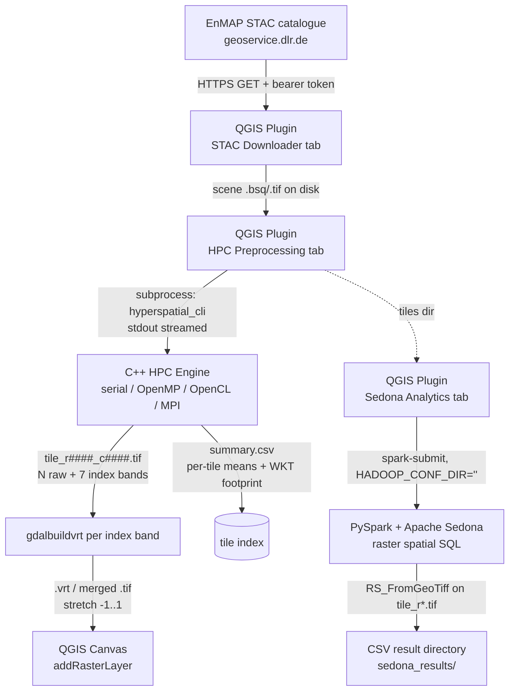

# HyperSpatial Big Data — Architecture

A **local-first** pipeline that turns a gigabyte-scale hyperspectral scene into
map layers and distributed spatial analytics, entirely on local hardware. No
cloud services are used at any stage.

> **Scope of this document.** It is the authoritative, function-by-function
> description of the system: components, data lifecycles, the maths, the
> concurrency and memory models, the on-disk/stdout contracts, build & deploy,
> and the production-operations notes (error handling, exit codes, limits,
> known limitations). The rigid interface boundaries are specified in
> [connections.md](connections.md); this file explains *how and why* each
> component works.

---

## 0. Pipeline at a glance



The three components talk **only** through files on disk and subprocess stdout —
never shared memory, sockets, or a database. Each arrow is a versioned contract
(see [connections.md](connections.md)); breaking one tends to produce silent
empty/garbage output rather than a loud crash, which is why the contracts are
documented separately and defended in code.

### Repository layout

| Path | Role |
|------|------|
| `hpc-engine/` | C++17 preprocessor (headers in `include/`, sources in `src/`, OpenCL in `src/gpu/`) |
| `qgis-plugin/hyperspatial_bigdata/` | The unified QGIS plugin (UI orchestrator) |
| `qgis-plugin/hyperspatial_bigdata/bin/` | The **prebuilt** `hyperspatial_cli` the plugin runs (per-OS: `windows/`, `linux/`, `macos/`, or flat) |
| `qgis-plugin/hyperspatial_bigdata/spark-sedona/` | Bundled copy of the Spark jobs the plugin runs |
| `spark-sedona/` | Source of truth for the Spark/Sedona jobs |
| `docs/` | `architecture.md` (this file), `connections.md` |
| `data/` | Sample EnMAP L2A scene (ENVI `.bsq` + `.hdr` + quality layers) |
| `package_plugin.sh` | Builds the installable plugin zip |

---

## 1. C++ HPC Engine (`hpc-engine/`)

High-performance C++17 preprocessor. Two executables share one static core
library `hpc_core` (`src/RasterReader.cpp` + `src/TileWriter.cpp`, plus the
OpenCL backend when available):

* `hyperspatial_cli` — serial + OpenMP (`src/main.cpp`). **This is the binary the
  plugin ships and runs.**
* `hyperspatial_cli_mpi` — MPI + OpenMP (`src/main_mpi.cpp`). Optional; built only
  when `find_package(MPI)` succeeds. For multi-node / cluster runs.

The header-only processing stages (`include/*.hpp`) are deliberately split so each
is independently testable and the two `main`s share identical maths.

### 1.1 CLI

```
hyperspatial_cli --input <file> --output <dir> [options]
```

| Flag | Default | Meaning |
|------|---------|---------|
| `--input` | *(required)* | Any GDAL-readable raster (EnMAP ENVI `.bsq`/`.hdr`, GeoTIFF, …) |
| `--output` | *(required)* | Directory for `tile_r*.tif` + `summary.csv` (created; prior engine outputs cleared) |
| `--mode` | `openmp` if built with OpenMP, else `serial` | `serial` \| `openmp` \| `gpu` |
| `--tile-size` | `512` | Square tile edge in pixels |
| `--threads` | `0` (= all cores) | OpenMP threads; clamped to `hardware_concurrency()` |
| `--nodata-val` | `-9999` | Fallback nodata when the file declares none |
| `--nir-band` / `--red-band` / `--green-band` / `--swir-band` / `--blue-band` | *(auto)* | 1-based band override; pins that role and disables auto-selection for it |

Argument parsing is **crash-proof**: numeric conversions use guarded
`toInt`/`toFlt` helpers, so a malformed value (`--tile-size foo`) falls back to the
default instead of throwing `std::invalid_argument` and aborting the run.

### 1.2 Data lifecycle (per tile)

`main.cpp` reads the scene metadata once, resolves the spectral bands (§1.4),
builds the tile grid (`Tiler`), then processes tiles in a
`#pragma omp parallel for schedule(dynamic)` loop. Each iteration is wrapped in a
`try/catch` (see §1.6) and does:

1. **`RasterReader::readTile(bounds)`** — opens a **fresh** `GDALDataset` handle
   (GDAL datasets are not thread-safe; every worker gets its own handle via
   `GDALOpen`) and reads all bands of the tile as `float32`. A failed `RasterIO`
   now **throws** rather than silently yielding a zero (= nodata) tile.
2. **`NoDataHandler::apply`** — replaces the nodata sentinel (and any NaN/Inf)
   with `0.0f`, using an epsilon tolerance (`|v − nd| < 1e-3`) because the
   sentinel is stored as `double` in GDAL and narrows to `float` with sub-ULP
   error. **`0.0f` is the universal nodata marker for the rest of the pipeline.**
3. **`BadBandRemover::apply`** — **masks** (zero-fills) any band that is >50 %
   nodata or has ~zero variance (two-pass variance in `double` to avoid float32
   cancellation on high-DN data). It *masks* rather than *erases* so every output
   tile keeps an identical band count — critical for the VRT mosaic (§2) and the
   fixed index-band offset.
4. **`SpectralFeatures::compute`** — computes the 7 indices **before**
   normalisation (indices need raw reflectance ratios). Reflectance is de-scaled
   by 10 000 (EnMAP L2A integer scaling) so the additive-constant indices
   (EVI/SAVI/MSAVI) are correct. An index is written only where **all** of its
   operand bands are non-zero; otherwise it stays `0.0`.
5. **`Normalizer::apply`** — per-band min→max stretch of the raw visual bands into
   `[kEps, 1]` (`kEps = 1e-6`). Reserving exactly `0.0` keeps the darkest valid
   pixel distinguishable from true nodata. Indices are already final and are not
   normalised. *Stretch is per-tile* (see §1.7, limitation L1).
6. **`TileWriter::writeGeoTIFF`** — writes `tile_r####_c####.tif`
   (`COMPRESS=LZW TILED=YES`, `float32`), nodata = `0.0` on every band. A fully
   purged tile (0 bands) is skipped, not written empty.
7. **`TileWriter::appendSummaryCSV`** — appends one mutex-guarded row with the tile
   footprint (WKT + bbox), EPSG, and per-tile index means.

### 1.3 Band layout of every output tile

| Bands | Content |
|-------|---------|
| `1 .. N` | the raw/processed spectral bands (`N` = input band count, 224 for EnMAP) |
| `N+1 .. N+7` | NDVI, NDWI, NDBI, SAVI, EVI, NDMI, MSAVI — **fixed order** |

`first_index_band = N + 1` is written into `summary.csv`, and every downstream
reader derives index positions as an **offset from the band count**, never a
hard-coded number. Because `BadBandRemover` masks instead of erasing, `N` is
constant across all tiles of a scene, so the mosaic and the offset are stable.

### 1.4 Spectral-band resolution (wavelength-driven)

The indices are only meaningful if NIR/Red/Green/SWIR/Blue point at the right
*physical wavelengths*. Hard-coding GDAL band numbers is fragile — the correct
band for ~860 nm differs between sensors and even between EnMAP processor
versions.

* `RasterReader` auto-detects each band's **centre wavelength** from the file
  metadata (GDAL per-band `wavelength` metadata item, else the band description
  string such as `"Band 75 (863.40 nm)"`), handling nm/µm units.
* `BandResolver::resolveBandsFromWavelengths` then selects, for each role, the
  band **nearest** the canonical target (NIR 860, Red 660, Green 560, SWIR 1640,
  Blue 480 nm). Explicit `--*-band` flags pin a role and are never overridden.
* When the file exposes no wavelengths, the engine falls back to the
  `BandConfig` defaults, which are now the correct standard-EnMAP bands
  `{nir:75, red:47, green:30, swir:151, blue:14}`.

The engine prints the resolved bands and their wavelengths on startup, e.g.
`Bands: NIR=75(863.4nm) Red=47(660.0nm) Green=30(560.9nm) SWIR=152(1642.4nm) Blue=14(482.2nm)`.

> **Why this matters (bug fixed in this pass).** The previous hard-coded defaults
> `{88,40,25,160,10}` mapped to ~936 nm (NIR water-vapour), ~617 nm, ~535 nm,
> ~1739 nm and ~464 nm on real EnMAP data — the *wrong* physical bands — which
> systematically biased **every** index. Wavelength-driven resolution makes the
> output scientifically correct for any cube.

### 1.5 Spectral index formulas (`SpectralFeatures.hpp`)

With n=NIR, r=Red, g=Green, s=SWIR, b=Blue (reflectance 0–1), L=0.5:

| Index | Formula | Notes |
|-------|---------|-------|
| NDVI | (n − r) / (n + r) | vegetation |
| NDWI | (g − n) / (g + n) | open water (McFeeters 1996) |
| NDBI | (s − n) / (s + n) | built-up |
| NDMI | (n − s) / (n + s) | canopy moisture |
| SAVI | ((n − r) / (n + r + L)) · (1 + L) | soil-adjusted |
| EVI | 2.5 · (n − r) / (n + 6r − 7.5b + 1) | atmosphere/soil resistant |
| MSAVI | (2n + 1 − √((2n+1)² − 8(n − r))) / 2 | iteration-free modified SAVI |

All results are clamped to `[−1, 1]`. For the normalised-difference indices the
10 000 scale cancels; it matters only for EVI/SAVI/MSAVI, which is why the
de-scaling is applied. Division and `sqrt` discriminants are guarded so a
degenerate denominator or negative discriminant yields `0.0`, not NaN/Inf.

### 1.6 Advanced Hyperspectral Operations (PCA & SAM)

In addition to the standard 7 multi-spectral indices, the engine natively supports two true **Hyperspectral** operations that utilise the entire 224-band spectrum:

1. **Principal Component Analysis (PCA)** (`--operation pca`):
   - Compresses the full 224-band variance down to `N` dominant components (default: 3).
   - Generates `pca.tif` and a `pca_eigen.csv` log of the variance explained by each PC.
   - GPU execution uses a Kahan-compensated parallel reduction for the massive covariance matrix calculation to avoid `float32` drift on macOS.

2. **Spectral Angle Mapper (SAM)** (`--operation sam`):
   - Computes the N-dimensional angular distance between every pixel and a user-defined reference spectrum (`--sam-spectrum "v1,v2,v3..."`).
   - Produces `sam_angle.tif` (raw radians), `sam_mask.tif` (boolean classification mask based on `--sam-threshold`), and `sam_similarity.tif` (1.0 - angle/pi).

Both operations fully support OpenMP CPU threading and OpenCL GPU acceleration, bypassing the normal index routines entirely.

### 1.7 Concurrency, thread-safety & error model

* **GDAL handles are per-thread.** `readTile` opens its own `GDALDataset`; handles
  are never shared across threads. `TileWriter::writeGeoTIFF` creates a distinct
  file per tile, so writers never contend on a dataset.
* **The summary CSV is mutex-guarded.** All OpenMP threads append through a single
  `std::mutex`; the header is written once (detected under the lock, no TOCTOU).
* **Exceptions never escape the parallel region.** An exception propagating out of
  an OpenMP region is undefined behaviour (`std::terminate`). Every loop iteration
  catches `std::exception`, records the first error (atomic flag + mutex), and the
  run continues; the process then exits non-zero (**exit code 2**) with the first
  error on stderr. This turns a single bad tile into a reported failure instead of
  a hard abort or silent corruption.
* **Progress contract.** Stdout carries `Progress: k/total` lines and a final
  `RESULT mode=... tiles=... time_sec=...` line for benchmark scraping. The plugin
  only displays stdout and checks the **exit code**.

### 1.7 Memory model

Per in-flight tile the engine holds `tileSize² × N × 4 bytes` of band data
(≈ 235 MB for 512² × 224 bands) plus the 7 index arrays. With dynamic OpenMP each
active thread holds one tile, so peak RAM ≈ `threads × ~250 MB`. Tune `--tile-size`
down or `--threads` down on memory-constrained machines. The scene itself is
**never** loaded whole into memory — only one tile per worker at a time, which is
the core "don't read gigabytes into RAM" guarantee.

### 1.8 Compute backends (`--mode`)

| `--mode` | Backend | Notes |
|----------|---------|-------|
| `serial` | single-threaded CPU | deterministic baseline |
| `openmp` | multi-core CPU (default) | `schedule(dynamic)`, threads clamped to cores |
| `gpu` | **OpenCL** (`src/gpu/gpu_backend_opencl.cpp`) | one API for Apple / NVIDIA / Intel / AMD via `CL_DEVICE_TYPE_GPU` |
| `mpi` | MPI + OpenMP (`hyperspatial_cli_mpi`) | round-robin tile decomposition across ranks; `--mode gpu` honoured per rank |

The OpenCL kernel (`calc_index`) is a **line-for-line port** of
`SpectralFeatures.hpp` — same formulas, same ×10 000 de-scaling, same "all operands
non-zero or the index is 0.0" rule, same `[−1,1]` clamp — so `gpu` and `openmp`
produce identical rasters. The host side resolves bands by 1-based GDAL index,
serialises dispatch with a mutex (safe inside the OpenMP tile loop), and **falls
back to the CPU path per tile** if OpenCL init or any dispatch fails. If built
without an OpenCL SDK (`-DUSE_OPENCL=OFF` or none found), `--mode gpu` warns and
runs on CPU. The `RESULT mode=` line reports what actually ran (`gpu` only when the
GPU initialised).

The headers pin `CL_TARGET_OPENCL_VERSION=120` (OpenCL 1.2 — the common
denominator across all four vendors) in both `gpu_backend_opencl.cpp` and the
CMake target definitions. This keeps `clCreateCommandQueue` non-deprecated and,
on Linux/Windows, stops the Khronos headers from hiding the 1.x entry points the
backend uses (Apple's `<OpenCL/cl.h>` ignores the macro). On macOS the OpenCL
framework is built in; on Linux install an ICD loader + vendor runtime
(`ocl-icd-opencl-dev` + e.g. NVIDIA/Intel/`mesa-opencl-icd`); on Windows the GPU
driver supplies `OpenCL.dll` and `find_package(OpenCL)` links the SDK import lib.

> **MPI note.** On a single node, oversubscription is possible if each rank also
> spawns many OpenMP threads. The MPI binary defaults to **1 thread/rank**; raise
> `--threads` only when you have run `mpirun -np R` with `R` ≤ sockets, so
> `R × threads` ≤ cores.

---

## 2. QGIS Plugin (`qgis-plugin/hyperspatial_bigdata/`)

The **unified UI orchestrator**: a single modeless `HyperSpatialDialog`
(`dialog.py`) with a `QTabWidget` of three tabs. The golden rule is **never block
the UI thread** — every long-running job (download, the C++ engine,
`spark-submit`) runs in a `threading.Thread`, and results marshal back to the GUI
thread via `pyqtSignal`. The dialog is shown with `show()/raise_()/activateWindow()`
(never a modal `exec()`), so QGIS stays interactive.

### 2.1 STAC Downloader tab
`services/enmap_client.py` searches the DLR EnMAP STAC API
(`geoservice.dlr.de/.../ENMAP_HSI_L2A/items`) and streams a scene to
`~/Downloads/hyperspatial_data/<scene_id>/` in 1 MB chunks (constant RAM). TLS is
**verified** (certifi CA bundle preferred, system default fallback) because the
optional EOWEB bearer token travels in an `Authorization` header. An HTML response
on download is detected and reported as an authentication failure rather than
saved as a bogus `.tif`. Bbox parsing is validated inside the slot's `try`, so a
malformed `W,S,E,N` string surfaces as a dialog, not an uncaught exception.

`extract_metadata()` can additionally parse per-band wavelengths from the XML
sidecar and write a `metadata.json`. It is now **informational only** — the C++
engine reads wavelengths from the raster itself (§1.4), so the plugin no longer
needs to compute or pass band indices.

### 2.2 HPC Preprocessing tab
Runs `bin/hyperspatial_cli` via `subprocess.Popen` (stdout streamed to the log),
sets the execute bit best-effort (guarded `chmod` — a read-only install won't
abort the run), then post-processes on the worker thread:

* reads `RasterCount` from `tiles[0]` (guarded against a `None` open),
* computes `first_index_band = RasterCount − 7 + 1`,
* builds **one Virtual Raster per selected index** with
  `gdal.BuildVRT(..., bandList=[first_index_band + k])` for a **fixed** offset `k`
  (the offset must not depend on which checkboxes are ticked — otherwise
  unchecking NDVI would shift NDWI onto NDVI's band),
* optionally merges each VRT to a compressed GeoTIFF and deletes the per-tile
  chunks (merged-TIFF mode),
* adds each layer to the canvas via `iface.addRasterLayer` with a −1…1 stretch.

Checkbox state is captured on the GUI thread and passed to the worker; UI buttons
re-enable through `hpc_finished`/`spark_finished` signals emitted in `finally`, so
the UI always recovers even if a step raises.

### 2.3 Sedona Analytics tab
Launches a bundled PySpark job via `spark-submit` with `HADOOP_CONF_DIR=""` in the
child env (a populated value triggers local XML parsing that crashes the JVM on
macOS). `spark-submit` is resolved with `shutil.which`; if absent (QGIS launched
from the GUI without the env on PATH) it falls back to the user's login shell
(`$SHELL -l -c`, not a hard-coded `zsh`). Each query builds the **exact** argument
list its argparse contract declares (see [connections.md](connections.md) §4) and
the worker reports the child's **exit code** — a non-zero exit is shown as a
failure, not a false "complete".

---

## 3. Apache Sedona Analytics (`spark-sedona/`)

Distributed, **per-pixel** spatial analytics over the engine's actual output
rasters (`tile_r*.tif`) using Sedona's raster functions (`RS_*`) — not a
precomputed tile average. `utils/sedona_session.py` builds the `SedonaContext`
with the pinned Sedona 1.5.1 / GeoTools jars; `utils/raster_io.py::load_tiles`
loads the tiles.

**How it loads.** `spark.read.format("binaryFile")` reads each `tile_r*.tif`,
`RS_FromGeoTiff(content)` turns it into a Sedona `Raster`, and the trailing index
bands are addressed by offset from `RS_NumBands` (NDVI = `nbands − 6` =
`first_index_band`, NDWI `−5`, …, MSAVI `−0`). Each raster carries its own SRID
(`RS_SRID`); rows with unknown SRID (0) are dropped. Tile footprints for the
intersect pre-filter are `ST_Transform(ST_SetSRID(RS_Envelope(rast), RS_SRID(rast)),
'epsg:4326')`, and `RS_ZonalStats` reprojects the AOI/field zone into each
raster's CRS internally — so AOI polygons are supplied in EPSG:4326 and need no
manual transform.

| Job | CLI | What it does (per pixel) |
|-----|-----|---------------------------|
| `q1_aoi_filter.py` | `--rasters --output --aoi` | NDVI zonal stats over pixels inside an AOI |
| `q2_spatial_join.py` | `--rasters --agri --output` | zonal NDVI/NDWI/NDBI per field, pixel-count-weighted across tiles (a true per-field mean, not an average of per-tile averages) |
| `q3_ndvi_filter.py` | `--rasters --output [--threshold]` | per-pixel mean NDVI + vegetation-pixel fraction per tile |
| `q4_partitioning_benchmark.py` | `--rasters --agri [--csv-out]` | raster zonal-join timing, plain vs hash repartition (standalone) |

**No GeoParquet / pyarrow in the Spark JVM** — it collides fatally with the system
`libgdal` on macOS. Inputs are GeoTIFF, zones are WKT/GeoJSON, outputs are CSV
directories (`mode("overwrite")`). AOIs are read with `json` + `shapely` (no
GeoPandas/Fiona); a FeatureCollection is dissolved with `shapely.unary_union`.

**Memory note.** `RS_FromGeoTiff` loads a whole tile (all `N+7` bands) into the JVM
per row — heavier than a CSV scan, which is the cost of true per-pixel analysis.
Run the HPC tab in **VRT output mode** so the per-tile GeoTIFFs are retained
(merged-TIFF mode deletes them, and analytics then has nothing to read).

---

## 4. `summary.csv` — tile index (written every run)

```
tile_id,tile_path,epsg,xmin,ymin,xmax,ymax,ndvi,ndwi,ndbi,savi,evi,ndmi,msavi,first_index_band,geometry_wkt
```

* `epsg` — native CRS authority code; `ndvi…msavi` — per-tile means over valid
  (non-zero) pixels; `first_index_band` — 1-based NDVI band; `geometry_wkt` —
  footprint polygon (CCW exterior ring, OGC order) in the native CRS.
* The engine **clears its own prior outputs** (`summary.csv` + `tile_r*`) at the
  start of every run, so re-running into the same directory never accumulates
  duplicate rows or folds stale tiles from an earlier, differently-tiled scene into
  the mosaic. (The MPI path writes per-rank temp CSVs that rank 0 merges, with the
  `std::ios::trunc` final write doing the same job.)
* The Sedona jobs read the `tile_r*.tif` rasters **directly**, so this file is a
  lightweight quick-look tile index, not the analytics input.

---

## 5. Build & deployment

### 5.1 Building the engine
```bash
cmake -S hpc-engine -B hpc-engine/build -DCMAKE_BUILD_TYPE=Release
cmake --build hpc-engine/build -j
```
Dependencies: GDAL (required), OpenMP (optional; auto-detected via Homebrew
`libomp` on macOS), OpenCL (optional, `-DUSE_OPENCL=ON` default), MPI (optional).

* **Portability:** the build defaults to a portable optimised build (`-O3` on
  GCC/Clang, `/O2` on MSVC). `-march=native` is **off** by default and opt-in via
  `-DNATIVE_ARCH=ON` (GCC/Clang only) — a `-march=native` binary aborts with
  SIGILL on a different/older CPU, and the plugin ships a *prebuilt* binary.
* Copy the resulting `hyperspatial_cli` into the plugin's `bin/`. The engine is a
  native per-OS executable, so a cross-platform plugin uses one sub-folder per OS
  — `bin/windows/hyperspatial_cli.exe`, `bin/linux/hyperspatial_cli`,
  `bin/macos/hyperspatial_cli` (macOS and Linux share the file name and cannot
  co-exist flat). `dialog.py::_resolve_cli` picks the host's variant; a flat
  `bin/hyperspatial_cli[.exe]` is still accepted for a single-OS package. Rebuild
  per target OS/architecture.

### 5.2 Python / Spark environment
`environment.yml` pins Python 3.11, GDAL 3.10, PySpark 3.4, Shapely ≥2, and
`apache-sedona[spark]==1.5.1`; all geospatial libs come from `conda-forge` so they
share one `libarrow`. `HADOOP_CONF_DIR` must be unset for Spark on macOS.

### 5.3 Packaging the plugin
```bash
./package_plugin.sh
```
Produces `hyperspatial_bigdata.zip` (installable via QGIS → Plugins → Install from
ZIP). It **includes** the required `bin/hyperspatial_cli` and the bundled
`spark-sedona/` jobs; only caches/scratch are excluded. There are two copies of the
Spark jobs (top-level source and the bundled copy the plugin actually runs) — keep
them in sync (they are currently identical; verify after any job edit).

---

## 6. Known limitations

| # | Limitation | Mitigation |
|---|------------|------------|
| L1 | **Per-tile normalisation seams** — each raw-band tile is stretched by its own min/max, so identical reflectance can map to different display values across tiles. Index bands are unaffected (computed before normalisation). | Disable normalisation for scientific output (physical reflectance is already mosaic-consistent), or add a global two-pass min/max. |
| L2 | **`BadBandRemover` runs before `SpectralFeatures`** — a band >50 % nodata is masked wholesale, so its valid pixels don't contribute to indices. | Defensible "bad band" definition; swap the stage order to keep those pixels. |
| L3 | **Sedona `ST_Transform(geom,'epsg:4326')` axis order** — GeoTools treats EPSG:4326 as lat/lon; on some builds a known-overlapping join can return empty if coordinates are swapped. | Verify on real UTM data; wrap with `ST_FlipCoordinates` or use the 3-arg `ST_Transform` if needed. |
| L4 | **Mean-of-indices in `summary.csv` excludes exactly 0.0**, conflating a true nodata pixel with a legitimate index value of 0. | Minor statistical bias; the authoritative per-pixel stats come from the Sedona jobs. |
| L5 | **Downloaded asset is always named `.tif`**; some EnMAP "data" assets are ZIP archives. | Derive the extension from the URL/`Content-Type`, or unzip before preprocessing. |

---

## 7. Production hardening changelog (this pass)

| Area | Change |
|------|--------|
| `RasterReader` | Auto-detect per-band centre wavelengths from GDAL metadata/description (nm/µm aware). |
| `BandResolver.hpp` (new) | Select NIR/Red/Green/SWIR/Blue by nearest wavelength; CLI flags pin a role. |
| `RasterReader.hpp`, `main*.cpp` | **Corrected** the wrong hard-coded EnMAP band defaults (`88/40/25/160/10` → `75/47/30/151/14`); engine prints resolved bands. |
| `RasterReader::readTile` | Throw on failed `RasterIO` read instead of silently emitting a nodata tile. |
| `TileWriter::writeGeoTIFF` | Check `RasterIO` write return values and throw on failure (also silences `warn_unused_result`). |
| `main.cpp`, `main_mpi.cpp` | Per-iteration `try/catch` so no exception escapes the OpenMP region (UB); report the first error and exit code **2** on any tile failure (MPI combines via `MPI_Allreduce`). |
| `dialog.py` | Guard `gdal.Open(tiles[0])` returning `None` before the VRT merge. |
| Bundled binary | `qgis-plugin/.../bin/hyperspatial_cli` rebuilt from the corrected engine. |

Earlier audit passes (see `BUGS_AND_FIXES.md`) fixed the Spark argument contracts,
the AOI picker, the unset-locale crash, verified TLS, the `summary.csv`
accumulation, the Normalizer/nodata collision, portable build flags, and the
uniform band layout.
