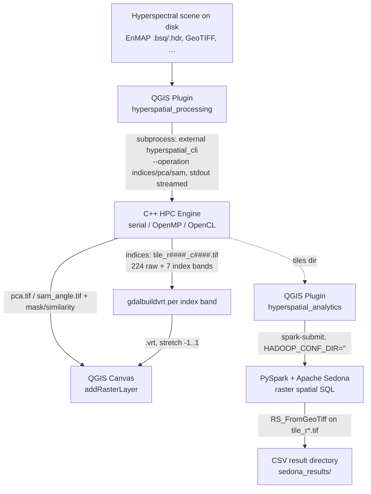

# HyperSpatial Big Data — Architecture

A **local-first** pipeline that turns a gigabyte-scale hyperspectral scene into
map layers and distributed spatial analytics, entirely on local hardware. No
cloud services are used at any stage.

> **Scope of this document.** It is the authoritative, function-by-function
> description of the system: components, data lifecycles, the maths, the
> concurrency and memory models, the on-disk/stdout contracts, build & deploy,
> and the production-operations notes (error handling, exit codes, limits,
> known limitations). The rigid interface boundaries are specified in
> [connections.md](connections.md); this file explains *how and why* each
> component works.

---

## 0. Pipeline at a glance



The system is **two independent QGIS plugins** plus an external C++ engine, and
they talk **only** through files on disk and subprocess stdout — never shared
memory, sockets, or a database. There is no cloud dependency and no download
step: the input scene is already on local disk. Each arrow is a versioned
contract (see [connections.md](connections.md)); breaking one tends to produce
silent empty/garbage output rather than a loud crash, which is why the contracts
are documented separately and defended in code.

### Repository layout

| Path | Role |
|------|------|
| `hpc-engine/` | External C++17 preprocessor (headers in `include/`, sources in `src/`, OpenCL in `src/gpu/`); built and installed separately — the plugins ship **without** it |
| `qgis-plugin/hyperspatial_processing/` | QGIS plugin #1 — UI orchestrator that drives the external engine (binary-free zip) |
| `qgis-plugin/hyperspatial_analytics/` | QGIS plugin #2 — UI orchestrator for the PySpark/Sedona jobs; bundles its own `spark-sedona/` copy |
| `spark-sedona/` | Source of truth for the Spark/Sedona jobs |
| `qgis-plugin/hyperspatial_analytics/hyperspatial_analytics/spark-sedona/` | Bundled copy of the Spark jobs the analytics plugin runs |
| `docs/` | `architecture.md` (this file), `connections.md` |
| `data/` | Sample EnMAP L2A scene (ENVI `.bsq` + `.hdr` + quality layers) |
| `qgis-plugin/*/package_plugin.sh` | Each plugin builds its own installable zip |

---

## 1. C++ HPC Engine (`hpc-engine/`)

High-performance C++17 preprocessor, built and installed **separately** from the
plugins (the `hyperspatial_processing` zip ships binary-free and resolves this
engine at run time — see §2.1). A single executable `hyperspatial_cli`
(`src/main.cpp`) is built on a static core library `hpc_core`
(`src/RasterReader.cpp` + `src/TileWriter.cpp`, plus the OpenCL backend when
available). It runs serial, OpenMP, or OpenCL GPU; there is no MPI build.

The header-only processing stages (`include/*.hpp`) are deliberately split so each
is independently testable.

### 1.1 CLI

```
hyperspatial_cli --input <file> --output <dir> --operation <indices|pca|sam> [options]
```

| Flag | Default | Meaning |
|------|---------|---------|
| `--input` | *(required)* | Any GDAL-readable raster (EnMAP ENVI `.bsq`/`.hdr`, GeoTIFF, …) |
| `--output` | *(required)* | Directory for the operation's outputs (created; prior engine outputs cleared) |
| `--operation` | `indices` | `indices` (7 spectral indices) \| `pca` (false-colour PC composite) \| `sam` (Spectral Angle Mapper) |
| `--mode` | `openmp` if built with OpenMP, else `serial` | `serial` \| `openmp` \| `gpu` |
| `--tile-size` | `512` | Square tile edge in pixels |
| `--threads` | `0` (= all cores) | OpenMP threads; clamped to `hardware_concurrency()` |
| `--nodata-val` | `-9999` | Fallback nodata when the file declares none |
| `--nir-band` / `--red-band` / `--green-band` / `--swir-band` / `--blue-band` | *(auto)* | 1-based band override; pins that role and disables auto-selection for it |
| `--pca-components` | `3` | (PCA) number of principal components written to `pca.tif` |
| `--pca-matrix` | `covariance` | (PCA) `covariance` or `correlation` |
| `--sam-spectrum` | *(required for SAM)* | Comma-separated reference spectrum (the plugin fills this from a canvas-picked pixel) |
| `--sam-threshold` | *(off)* | (SAM) angle in radians; when set, also writes a 0/1 `sam_mask.tif` |
| `--sam-emit-similarity` | *(off)* | (SAM) also write `sam_similarity.tif` (`1 − angle/π`) |

Argument parsing is **crash-proof**: numeric conversions use guarded
`toInt`/`toFlt` helpers, so a malformed value (`--tile-size foo`) falls back to the
default instead of throwing `std::invalid_argument` and aborting the run.

### 1.2 Data lifecycle (per tile, `--operation indices`)

`main.cpp` reads the scene metadata once, resolves the spectral bands (§1.4),
builds the tile grid (`Tiler`), then processes tiles in a
`#pragma omp parallel for schedule(dynamic)` loop. Each iteration is wrapped in a
`try/catch` (see §1.6) and does:

1. **`RasterReader::readTile(bounds)`** — opens a **fresh** `GDALDataset` handle
   (GDAL datasets are not thread-safe; every worker gets its own handle via
   `GDALOpen`) and reads all bands of the tile as `float32`. A failed `RasterIO`
   now **throws** rather than silently yielding a zero (= nodata) tile.
2. **`NoDataHandler::apply`** — replaces the nodata sentinel (and any NaN/Inf)
   with `0.0f`, using an epsilon tolerance (`|v − nd| < 1e-3`) because the
   sentinel is stored as `double` in GDAL and narrows to `float` with sub-ULP
   error. **`0.0f` is the universal nodata marker for the rest of the pipeline.**
3. **`BadBandRemover::apply`** — **masks** (zero-fills) any band that is >50 %
   nodata or has ~zero variance (two-pass variance in `double` to avoid float32
   cancellation on high-DN data). It *masks* rather than *erases* so every output
   tile keeps an identical band count — critical for the VRT mosaic (§2) and the
   fixed index-band offset.
4. **`SpectralFeatures::compute`** — computes the 7 indices **before**
   normalisation (indices need raw reflectance ratios). Reflectance is de-scaled
   by 10 000 (EnMAP L2A integer scaling) so the additive-constant indices
   (EVI/SAVI/MSAVI) are correct. An index is written only where **all** of its
   operand bands are non-zero; otherwise it stays `0.0`.
5. **`Normalizer::apply`** — per-band min→max stretch of the raw visual bands into
   `[kEps, 1]` (`kEps = 1e-6`). Reserving exactly `0.0` keeps the darkest valid
   pixel distinguishable from true nodata. Indices are already final and are not
   normalised. *Stretch is per-tile* (see §1.7, limitation L1).
6. **`TileWriter::writeGeoTIFF`** — writes `tile_r####_c####.tif`
   (`COMPRESS=LZW TILED=YES`, `float32`), nodata = `0.0` on every band. A fully
   purged tile (0 bands) is skipped, not written empty. These per-tile GeoTIFFs
   are the only engine output and are the direct bridge to the analytics plugin
   (§3) — there is no `summary.csv`.

The `pca` and `sam` operations bypass this per-tile index pipeline and write a
single composite raster instead (§1.6).

### 1.3 Band layout of every output tile

| Bands | Content |
|-------|---------|
| `1 .. N` | the raw/processed spectral bands (`N` = input band count, 224 for EnMAP) |
| `N+1 .. N+7` | NDVI, NDWI, NDBI, SAVI, EVI, NDMI, MSAVI — **fixed order** |

`first_index_band = N + 1`, and every downstream reader derives index positions
as an **offset from the band count**, never a hard-coded number. Because
`BadBandRemover` masks instead of erasing, `N` is constant across all tiles of a
scene, so the mosaic and the offset are stable.

### 1.4 Spectral-band resolution (wavelength-driven)

The indices are only meaningful if NIR/Red/Green/SWIR/Blue point at the right
*physical wavelengths*. Hard-coding GDAL band numbers is fragile — the correct
band for ~860 nm differs between sensors and even between EnMAP processor
versions.

* `RasterReader` auto-detects each band's **centre wavelength** from the file
  metadata (GDAL per-band `wavelength` metadata item, else the band description
  string such as `"Band 75 (863.40 nm)"`), handling nm/µm units.
* `BandResolver::resolveBandsFromWavelengths` then selects, for each role, the
  band **nearest** the canonical target (NIR 860, Red 660, Green 560, SWIR 1640,
  Blue 480 nm). Explicit `--*-band` flags pin a role and are never overridden.
* When the file exposes no wavelengths, the engine falls back to the
  `BandConfig` defaults, which are now the correct standard-EnMAP bands
  `{nir:75, red:47, green:30, swir:151, blue:14}`.

The engine prints the resolved bands and their wavelengths on startup, e.g.
`Bands: NIR=75(863.4nm) Red=47(660.0nm) Green=30(560.9nm) SWIR=152(1642.4nm) Blue=14(482.2nm)`.

> **Why this matters (bug fixed in this pass).** The previous hard-coded defaults
> `{88,40,25,160,10}` mapped to ~936 nm (NIR water-vapour), ~617 nm, ~535 nm,
> ~1739 nm and ~464 nm on real EnMAP data — the *wrong* physical bands — which
> systematically biased **every** index. Wavelength-driven resolution makes the
> output scientifically correct for any cube.

### 1.5 Spectral index formulas (`SpectralFeatures.hpp`)

With n=NIR, r=Red, g=Green, s=SWIR, b=Blue (reflectance 0–1), L=0.5:

| Index | Formula | Notes |
|-------|---------|-------|
| NDVI | (n − r) / (n + r) | vegetation |
| NDWI | (g − n) / (g + n) | open water (McFeeters 1996) |
| NDBI | (s − n) / (s + n) | built-up |
| NDMI | (n − s) / (n + s) | canopy moisture |
| SAVI | ((n − r) / (n + r + L)) · (1 + L) | soil-adjusted |
| EVI | 2.5 · (n − r) / (n + 6r − 7.5b + 1) | atmosphere/soil resistant |
| MSAVI | (2n + 1 − √((2n+1)² − 8(n − r))) / 2 | iteration-free modified SAVI |

All results are clamped to `[−1, 1]`. For the normalised-difference indices the
10 000 scale cancels; it matters only for EVI/SAVI/MSAVI, which is why the
de-scaling is applied. Division and `sqrt` discriminants are guarded so a
degenerate denominator or negative discriminant yields `0.0`, not NaN/Inf.

### 1.6 Advanced Hyperspectral Operations (PCA & SAM)

In addition to the standard 7 multi-spectral indices, the engine natively supports two true **Hyperspectral** operations that utilise the entire 224-band spectrum:

1. **Principal Component Analysis (PCA)** (`--operation pca`):
   - Compresses the full 224-band variance down to `N` dominant components (default: 3).
   - Generates `pca.tif` and a `pca_eigen.csv` log of the variance explained by each PC.
   - GPU execution uses a Kahan-compensated parallel reduction for the massive covariance matrix calculation to avoid `float32` drift on macOS.

2. **Spectral Angle Mapper (SAM)** (`--operation sam`):
   - Computes the N-dimensional angular distance between every pixel and a reference spectrum (`--sam-spectrum "v1,v2,v3..."`). In the `hyperspatial_processing` plugin that reference spectrum is captured interactively from a **canvas-picked pixel** (§2.1).
   - Produces `sam_angle.tif` (raw radians); with `--sam-threshold` also `sam_mask.tif` (boolean classification mask), and with `--sam-emit-similarity` also `sam_similarity.tif` (`1.0 − angle/π`).

Both operations fully support OpenMP CPU threading and OpenCL GPU acceleration, bypassing the normal index routines entirely.

### 1.7 Concurrency, thread-safety & error model

* **GDAL handles are per-thread.** `readTile` opens its own `GDALDataset`; handles
  are never shared across threads. `TileWriter::writeGeoTIFF` creates a distinct
  file per tile, so writers never contend on a dataset.
* **Exceptions never escape the parallel region.** An exception propagating out of
  an OpenMP region is undefined behaviour (`std::terminate`). Every loop iteration
  catches `std::exception`, records the first error (atomic flag + mutex), and the
  run continues; the process then exits non-zero (**exit code 2**) with the first
  error on stderr. This turns a single bad tile into a reported failure instead of
  a hard abort or silent corruption.
* **Progress contract.** Stdout carries `Progress: k/total` lines and a final
  `RESULT mode=... tiles=... time_sec=...` line for benchmark scraping. The plugin
  only displays stdout and checks the **exit code**.

### 1.7 Memory model

Per in-flight tile the engine holds `tileSize² × N × 4 bytes` of band data
(≈ 235 MB for 512² × 224 bands) plus the 7 index arrays. With dynamic OpenMP each
active thread holds one tile, so peak RAM ≈ `threads × ~250 MB`. Tune `--tile-size`
down or `--threads` down on memory-constrained machines. The scene itself is
**never** loaded whole into memory — only one tile per worker at a time, which is
the core "don't read gigabytes into RAM" guarantee.

### 1.8 Compute backends (`--mode`)

| `--mode` | Backend | Notes |
|----------|---------|-------|
| `serial` | single-threaded CPU | deterministic baseline |
| `openmp` | multi-core CPU (default) | `schedule(dynamic)`, threads clamped to cores |
| `gpu` | **OpenCL** (`src/gpu/gpu_backend_opencl.cpp`) | one API for Apple / NVIDIA / Intel / AMD via `CL_DEVICE_TYPE_GPU`; **OpenMP CPU fallback** per tile if OpenCL is unavailable or fails |

The OpenCL kernel (`calc_index`) is a **line-for-line port** of
`SpectralFeatures.hpp` — same formulas, same ×10 000 de-scaling, same "all operands
non-zero or the index is 0.0" rule, same `[−1,1]` clamp — so `gpu` and `openmp`
produce identical rasters. The host side resolves bands by 1-based GDAL index,
serialises dispatch with a mutex, and **falls back to the CPU path per tile** if
OpenCL init or any dispatch fails. **In gpu mode the tile loop runs on a single
host thread** (`#pragma omp parallel for … if(runParallel && !use_gpu)`): Apple's
OpenCL queue was found to corrupt results when driven from several host threads
even behind the mutex. Tile reads and writes are therefore serial in gpu mode,
which is why an I/O-bound `indices` run is no faster on the GPU (9.1 s) than in
serial mode (8.5 s) on the Apple M4 Pro test machine. If built
without an OpenCL SDK (`-DUSE_OPENCL=OFF` or none found), `--mode gpu` warns and
runs on CPU. The `RESULT mode=` line reports what actually ran (`gpu` only when the
GPU initialised).

The headers pin `CL_TARGET_OPENCL_VERSION=120` (OpenCL 1.2 — the common
denominator across all four vendors) in both `gpu_backend_opencl.cpp` and the
CMake target definitions. This keeps `clCreateCommandQueue` non-deprecated and,
on Linux/Windows, stops the Khronos headers from hiding the 1.x entry points the
backend uses (Apple's `<OpenCL/cl.h>` ignores the macro). On macOS the OpenCL
framework is built in; on Linux install an ICD loader + vendor runtime
(`ocl-icd-opencl-dev` + e.g. NVIDIA/Intel/`mesa-opencl-icd`); on Windows the GPU
driver supplies `OpenCL.dll` and `find_package(OpenCL)` links the SDK import lib.

---

## 2. QGIS Plugins

The UI is **two independent plugins**, each a single modeless dialog
(`HyperSpatialDialog`-style window). The golden rule in both is **never block the
UI thread** — every long-running job (the C++ engine, `spark-submit`) runs in a
`threading.Thread`, and results marshal back to the GUI thread via `pyqtSignal`.
Each dialog is shown with `show()/raise_()/activateWindow()` (never a modal
`exec()`), so QGIS stays interactive. (A former third "STAC downloader" plugin for
DLR/EnMAP scenes has been removed; the input scene is supplied directly from
disk.)

### 2.1 `hyperspatial_processing` — engine orchestrator
This plugin ships **binary-free**: the compiled `hyperspatial_cli` is *not* inside
the zip. `engine_locator.resolve_engine()` finds it at run time in priority order:
(1) a saved setting / **Browse** choice, (2) `hyperspatial_cli` on the system
`PATH`, (3) a bundled `bin/<platform>/` copy (dev builds only). `engine_env()`
prepends QGIS's own GDAL library directory so the external engine links the exact
GDAL QGIS uses.

The **Operation** dropdown selects `--operation`:

* **Spectral Indices** — runs the per-tile pipeline (§1.2), then post-processes on
  the worker thread: reads `RasterCount` from `tiles[0]` (guarded against a `None`
  open), computes `first_index_band = RasterCount − 7 + 1`, and builds **one
  Virtual Raster per selected index** with `gdal.BuildVRT(..., bandList=[first_index_band + k])`
  for a **fixed** offset `k` (the offset must not depend on which checkboxes are
  ticked — otherwise unchecking NDVI would shift NDWI onto NDVI's band), adding
  each with a −1…1 stretch.
* **PCA (false-colour composite)** — passes `--pca-components` (and optionally
  `--pca-matrix correlation`); loads the resulting `pca.tif` as a 3-band
  false-colour PC composite.
* **Target Detection (SAM)** — the user clicks **Pick reference pixel** on the
  canvas; the captured spectrum is passed as `--sam-spectrum`, optionally with
  `--sam-threshold` (writes `sam_mask.tif`) and `--sam-emit-similarity`. Loads
  `sam_angle.tif` plus any mask/similarity bands.

The **Backend** dropdown sets `--mode` (`openmp` CPU or `gpu` OpenCL; `gpu`
self-falls-back to CPU). The engine subprocess runs via `subprocess.Popen` with
stdout streamed to the log; UI buttons re-enable through `hpc_finished` emitted in
`finally`, so the UI always recovers even if a step raises.

### 2.2 `hyperspatial_analytics` — Sedona orchestrator
Launches a bundled PySpark job via `spark-submit` with `HADOOP_CONF_DIR=""` in the
child env (a populated value triggers local XML parsing that crashes the JVM on
macOS). The Sedona JVM jars are put on the `spark-submit` command line with
`--packages` (`org.apache.sedona:sedona-spark-shaded-3.4_2.12:1.5.1` +
`org.datasyslab:geotools-wrapper:1.5.1-28.2`) — a `SedonaContext` config has no
effect once the JVM is already started. `spark-submit` is resolved with
`shutil.which`; if absent (QGIS launched from Finder without the env on PATH) the
user sets it via **Browse**. A radio group picks the query (Q1–Q5, §3); the worker
reports the child's **exit code** — a non-zero exit is shown as a failure, not a
false "complete". `spark_env()` also drops `PYTHONHOME`/`PYTHONPATH` from the child
env: QGIS's embedded Python may export them, and the Spark env's (different
version) interpreter would otherwise load QGIS's stdlib and die before Spark
starts. For **Q4 (Raw cube NDVI)** the plugin first auto-detects RED/NIR
from the cube's wavelength metadata (`raster_prep.detect_red_nir`) and extracts a
2-band RED+NIR GeoTIFF before submitting the job. For **Q5 (K-Means)** a worker
thread picks blue/green/red/NIR/SWIR1/SWIR2 by wavelength
(`raster_prep.detect_bands`), tiles them at 256 px (`prepare_band_tiles`), runs
the job, and mosaics the per-tile class maps into one VRT; the GUI slot adds it
with a paletted legend built from the job's `clusters.csv`.

**Raw-cube tile contract (Q4/Q5).** `gdal.Translate` copies the cube's
scale/offset into the GeoTIFF (EnMAP: ENVI `data gain values` = 0.0001) and
GeoTools **applies it on read**, so EnMAP's −32768 background reaches Sedona as
−3.2768 and no nodata test matches. `prepare_band_tiles` therefore strips
scale/offset and the nodata flag (tiles keep raw stored values) and returns the
source nodata, which the plugin passes to the job as `--nodata`. Before this,
Q4 averaged the ~30 % background in as NDVI 0 (EnMAP test scene: 0.393 instead
of 0.562).

---

## 3. Apache Sedona Analytics (`spark-sedona/`)

Distributed, **per-pixel** spatial analytics over the engine's actual output
rasters (`tile_r*.tif`) using Sedona's raster functions (`RS_*`). The jobs run
via `spark-submit` with the pinned Sedona jars on `--packages`
(`sedona-spark-shaded-3.4_2.12:1.5.1` + `geotools-wrapper:1.5.1-28.2`);
`utils/sedona_session.py` builds the `SedonaContext` and
`utils/raster_io.py::load_tiles` loads the tiles.

**How it loads.** `spark.read.format("binaryFile")` reads each `tile_r*.tif`,
`RS_FromGeoTiff(content)` turns it into a Sedona `Raster`, and the trailing index
bands are addressed by offset from `RS_NumBands` (NDVI = `nbands − 6` =
`first_index_band`, NDWI `−5`, …, MSAVI `−0`). Each raster carries its own SRID
(`RS_SRID`); rows with unknown SRID (0) are dropped. Tile footprints for the
intersect pre-filter are `ST_Transform(ST_SetSRID(RS_Envelope(rast), RS_SRID(rast)),
'epsg:4326')`, and `RS_ZonalStats` reprojects the AOI/field zone into each
raster's CRS internally — so AOI polygons are supplied in EPSG:4326 and need no
manual transform.

| Job | CLI | What it does (per pixel) |
|-----|-----|---------------------------|
| `q1_aoi_filter.py` (Q1) | `--rasters --output --aoi` | NDVI zonal stats over pixels inside an AOI |
| `q2_spatial_join.py` (Q2) | `--rasters --agri --output` | zonal NDVI/NDWI/NDBI per field, pixel-count-weighted across tiles (a true per-field mean, not an average of per-tile averages) |
| `q3_ndvi_filter.py` (Q3) | `--rasters --output [--threshold] [--raster-out]` | per-pixel mean NDVI + vegetation-pixel fraction per tile; with `--raster-out`, also writes a per-pixel veg-mask GeoTIFF per tile (via `RS_MapAlgebra`) for loading onto the canvas |
| `q_raw_ndvi.py` (Q4, Raw cube NDVI) | `--rasters --output --red-band --nir-band [--nodata] [--threshold] [--raster-out]` | computes NDVI per-pixel straight from a raw BSQ/ENVI/GeoTIFF cube via `RS_MapAlgebra`, **independent of the engine**; the plugin auto-detects RED/NIR from wavelengths and extracts a 2-band cube first; pixels whose RED or NIR equals `--nodata` are excluded |
| `q5_kmeans.py` (Q5, K-Means land cover) | `--rasters --output [--raster-out] [--k 8] [--features shape_brightness\|shape\|raw] [--sample 0.1] [--nodata] [--scale] [--roles] [--seed 42] [--verify]` | **unsupervised ML**: Spark MLlib K-Means on the pixels of a 6-band raw-cube subset, then the model is compiled to one Jiffle script (`utils/ml_jiffle.py`) and applied to every pixel with `RS_MapAlgebra` → byte class map per tile (nodata 255) + `clusters.csv` (suggested label from each cluster's mean NDVI/NDWI/NDSI) + `run_info.csv` |

**Q5 in more detail.** Pixels become rows with `RS_BandAsArray` + `arrays_zip` +
`posexplode`, per tile (a whole EnMAP scene as one raster row exhausts the default
1 GB driver heap; 256-px tiles do not). The feature transform exists twice —
Spark columns for training, Jiffle for mapping — both generated by
`ml_jiffle.py` from the same constants. Default features are the L2-normalised
spectrum (spectral *shape*, SAM-like, illumination-insensitive) plus one
log-brightness feature, which is what separates dark water from bright snow.
Validated on the EnMAP test scene (k = 8, seed 42; `tests/validate_raw_cube_jobs.py`):
Jiffle map = MLlib predictions on 100 % of 1,069,499 valid pixels; background =
EnMAP QL background exactly; the cluster labelled *Water* scores IoU 0.58
(precision 0.82) and *Snow/ice* precision 0.92 against the scene's DLR QL masks;
~12–15 s wall time. Raw-reflectance Euclidean K-Means scored snow IoU 0.41 and
found no water.

**No GeoParquet / pyarrow in the Spark JVM** — it collides fatally with the system
`libgdal` on macOS. Inputs are GeoTIFF, zones are WKT/GeoJSON, outputs are CSV
directories (`mode("overwrite")`). AOIs are read with `json` + `shapely` (no
GeoPandas/Fiona); a FeatureCollection is dissolved with `shapely.unary_union`.

**Memory note.** `RS_FromGeoTiff` decodes a whole tile per row. On the engine's
full `N+7`-band tiles (~242 MB per 512-px EnMAP tile) Q1–Q3 all hit
`OutOfMemoryError` — at the default 1 GB driver heap and still at 6 GB, because
local Spark decodes one tile per core in parallel. The plugin therefore copies
only the 7 index bands of each tile into a temp directory on its worker thread
(`raster_prep.extract_index_tiles`, ~2 s for an EnMAP scene) and runs Q1–Q3 on
those ~3.5 MB tiles at the default heap (each job ~7–9 s on the test scene).
Keep the engine's per-tile GeoTIFFs on disk (don't delete them after
mosaicking), otherwise the analytics plugin has nothing to read.

**Q3 NaN guard.** A tile with no valid pixels has `mean_ndvi = NaN`, and Spark SQL
orders NaN above every number, so `NaN >= threshold` was true and empty
background tiles were reported as vegetated (EnMAP scene: 7 reported, 4 real).
Q3 now filters `NOT isnan(mean_ndvi)`.

---

## 4. Build & deployment

### 4.1 Building the engine
```bash
cmake -S hpc-engine -B hpc-engine/build -DCMAKE_BUILD_TYPE=Release
cmake --build hpc-engine/build -j
```
Dependencies: GDAL (required), OpenMP (optional; auto-detected via Homebrew
`libomp` on macOS), OpenCL (optional, `-DUSE_OPENCL=ON` default).

* **Portability:** the build defaults to a portable optimised build (`-O3` on
  GCC/Clang, `/O2` on MSVC). `-march=native` is **off** by default and opt-in via
  `-DNATIVE_ARCH=ON` (GCC/Clang only) — a `-march=native` binary aborts with
  SIGILL on a different/older CPU.
* Install the resulting `hyperspatial_cli` somewhere the `hyperspatial_processing`
  plugin can find it — on the system `PATH` (e.g. `make install` / conda / Homebrew)
  or selected once via the plugin's **Browse** button. The plugin ships
  binary-free, so the engine is **not** bundled in the published zip; rebuild per
  target OS/architecture.

### 4.2 Python / Spark environment
`environment.yml` pins Python 3.11, GDAL 3.10, PySpark 3.4, Shapely ≥2, and
`apache-sedona[spark]==1.5.1`; all geospatial libs come from `conda-forge` so they
share one `libarrow`. The analytics plugin additionally puts the Sedona JVM jars
(`sedona-spark-shaded-3.4_2.12:1.5.1` + `geotools-wrapper:1.5.1-28.2`) on the
`spark-submit --packages` line. `HADOOP_CONF_DIR` must be unset for Spark on macOS.

### 4.3 Packaging the plugins
Each plugin has its own `package_plugin.sh`:
```bash
qgis-plugin/hyperspatial_processing/package_plugin.sh   # -> hyperspatial_processing.zip (binary-free)
qgis-plugin/hyperspatial_analytics/package_plugin.sh    # -> hyperspatial_analytics.zip (bundles spark-sedona/)
```
Both are installable via QGIS → Plugins → Install from ZIP. The processing zip
contains **no** compiled engine. The analytics zip bundles the Spark jobs; there
are two copies of those jobs (top-level `spark-sedona/` source and the bundled
copy the plugin runs) — keep them in sync (verify after any job edit).

---

## 5. Known limitations

| # | Limitation | Mitigation |
|---|------------|------------|
| L1 | **Per-tile normalisation seams** — each raw-band tile is stretched by its own min/max, so identical reflectance can map to different display values across tiles. Index bands are unaffected (computed before normalisation). | Disable normalisation for scientific output (physical reflectance is already mosaic-consistent), or add a global two-pass min/max. |
| L2 | **`BadBandRemover` runs before `SpectralFeatures`** — a band >50 % nodata is masked wholesale, so its valid pixels don't contribute to indices. The scene's own background counts as nodata, so **edge tiles that are >50 % background lose every index**: on the EnMAP test scene 3 of 9 tiles (60 %, 77 %, 97 % background) → **71,649 valid pixels (6.7 %) get no indices**, and Q3 sees those tiles as empty. | Measure the nodata fraction over the tile's valid footprint (pixels that are not all-band nodata) instead of the whole tile, or swap the stage order. |
| L3 | **Sedona `ST_Transform(geom,'epsg:4326')` axis order** — GeoTools treats EPSG:4326 as lat/lon; on some builds a known-overlapping join can return empty if coordinates are swapped. | **Verified OK on real UTM 32N data** with Sedona 1.5.1 + geotools-wrapper 1.5.1-28.2 (Q1 and Q2 return the expected tiles/zones on the EnMAP test scene); re-check if those versions change. |
| L4 | **`RS_ZonalStats` over `RS_Envelope(rast)` skips the raster's outermost pixel ring** (Q3/Q4 per-tile stats). On the EnMAP test scene this is 13 of 1,069,499 valid pixels; the mean is unaffected at 4 decimals. | Accept, or compute whole-raster stats with `RS_SummaryStats` instead of an envelope zone. |
| L5 | **Q5 clusters are not classes.** K-Means cannot isolate rare classes at small *k*, splits one material by illumination when brightness dominates, and does not separate clouds from snow (IoU ≤ 0.28 vs the QL cloud mask). Cluster numbers change with the seed; labels are threshold heuristics. | Use *k* ≈ 8 with shape+brightness features (validated default); treat `suggested_label` as a suggestion; use SAM for targeted detection. |

---

## 6. Production hardening changelog

| Area | Change |
|------|--------|
| `RasterReader` | Auto-detect per-band centre wavelengths from GDAL metadata/description (nm/µm aware). |
| `BandResolver.hpp` (new) | Select NIR/Red/Green/SWIR/Blue by nearest wavelength; CLI flags pin a role. |
| `RasterReader.hpp`, `main.cpp` | **Corrected** the wrong hard-coded EnMAP band defaults (`88/40/25/160/10` → `75/47/30/151/14`); engine prints resolved bands. |
| `RasterReader::readTile` | Throw on failed `RasterIO` read instead of silently emitting a nodata tile. |
| `TileWriter::writeGeoTIFF` | Check `RasterIO` write return values and throw on failure (also silences `warn_unused_result`). |
| `main.cpp` | Per-iteration `try/catch` so no exception escapes the OpenMP region (UB); report the first error and exit code **2** on any tile failure. |
| Advanced operations | Added `--operation pca` (false-colour PC composite) and `--operation sam` (Spectral Angle Mapper) alongside the 7 spectral indices. |
| Plugin split | Replaced the single monolithic plugin with two independent plugins (`hyperspatial_processing`, `hyperspatial_analytics`); the processing plugin ships binary-free and the STAC downloader and `summary.csv` bridge were removed in favour of GeoTIFFs read directly by Sedona. |
| `raster_prep` + `q_raw_ndvi.py` | **Fixed Q4 NDVI bias:** raw-cube tiles no longer carry the cube's scale/offset or nodata flag (GeoTools applied the 0.0001 gain, turning the −32768 background into −3.2768 and counting it as NDVI 0); the source nodata is passed as `--nodata`. Test scene: 0.393 → 0.562 (= NumPy). |
| `q5_kmeans.py`, `utils/ml_jiffle.py` | Added **Q5 K-Means land cover** (Spark MLlib → Jiffle class map), with unit tests (`tests/test_ml_jiffle.py`), an end-to-end validation (`tests/validate_raw_cube_jobs.py`) and a headless QGIS dialog smoke test (`tests/qgis_dialog_smoke.py`). |
| `spark_locator.spark_env` | Drops `PYTHONHOME`/`PYTHONPATH` from the spark-submit child env so QGIS's embedded-Python settings cannot break the Spark env's interpreter. |
| Q1–Q3 (`dialog.py`, `raster_prep.extract_index_tiles`) | **Fixed Q1–Q3 `OutOfMemoryError` on real engine output:** the worker thread passes 7-band index copies of the engine tiles instead of the full 231-band tiles. |
| `q3_ndvi_filter.py` | **Fixed** NaN (empty) tiles passing the NDVI threshold. |
